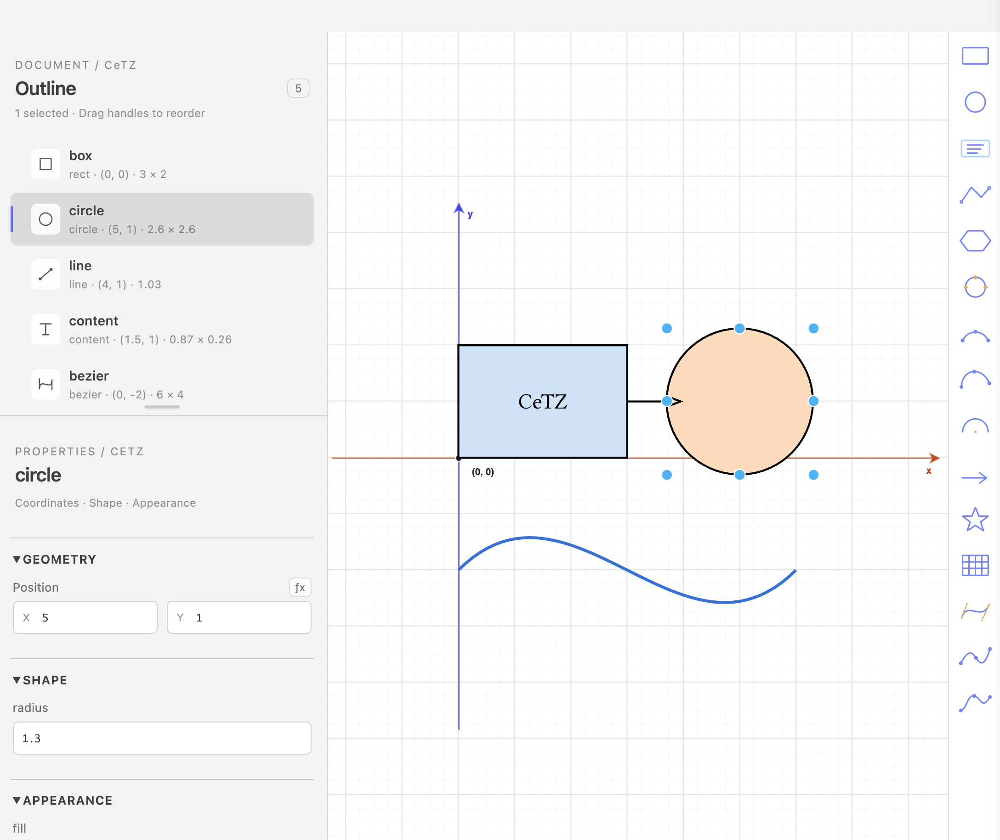

# GUI CeTZ

GUI CeTZ is a VS Code extension that opens `cetz.canvas({ ... })` in the existing [Draw.io Integration extension](https://github.com/hediet/vscode-drawio). The `.typ` file remains the source of truth. Every canvas, including one containing only CeTZ primitives, is rendered by Typst. Supported shapes carry their own SVG artwork. Live vector previews show movement, resizing, and control-point changes during the gesture; CeTZ recomputes the final appearance when the edit is committed.

## See it in action

GUI CeTZ supports visual editing alongside direct manipulation of Typst code. Open `examples/demo.typ` and click **▶ GUI CeTZ** to try the drawing shown below.

Select a shape in the canvas or Outline to edit its coordinates, size, fill, and stroke in Properties. Changes update the Typst source automatically.



## Properties inspector

Select a shape or its control point to open **Geometry**, **Shape**, **Appearance**, and **Advanced** sections in the left sidebar. Coordinates have separate X/Y inputs with unrestricted numeric precision; **ƒx** switches to a coordinate expression. Shape-specific fields include line `close`, circle radius, arc angles and mode, rectangle corner radius, star radii, curve tension, and content. Existing arguments and nested path bodies remain editable, and **Advanced → Add property** accepts additional CeTZ named arguments.

Fill and stroke offer Typst's named palette (`red`, `green`, `navy`, etc.) and an RGB picker. Stroke accepts both `1pt + black` and `black + 1pt`, or a dictionary such as `(paint: red, thickness: 2pt, dash: "dashed", cap: "round")`. Dedicated controls edit thickness, dash, cap, join, and line endpoint marks while preserving the other dictionary fields. Custom expressions remain available in the expression input.

Properties save automatically: text and numeric input is applied after a 400 ms pause or when the field is committed; menus apply immediately. Japanese IME input waits until composition finishes. The focused field and newer edits stay intact while Typst renders, including edits queued before selecting another shape. Clearing an optional field removes its explicit argument so CeTZ can inherit its style. Typst validates the resulting drawing before the source changes. Each automatic update is one undo step, and changing appearance immediately after dragging preserves the movement. Incomplete or invalid values remain in the inspector without an error banner, while the last valid source and drawing stay visible. Rendering updates automatically once Typst accepts the input, including corrections entered during validation.

The **Outline** uses the same visual style as Properties, with shape icons, object and group counts, and separate name and geometry lines. Expand or collapse groups with the chevron; selecting a hidden descendant in the canvas reveals it automatically. Selecting a control point highlights its owner in the Outline. Hover reveals reorder controls, while drag handles and modifier-click multiselection remain available. Drag the divider below Outline up or down to resize its panel; the height is remembered locally. Focus the divider and use the arrow keys for keyboard resizing, or double-click it to restore automatic sizing. Unrelated updates preserve the list and its scroll position. Light and dark themes share the same selection and focus styling.

## Linked 2D and 3D drawing

The top of Draw.io has **2D drawing** and **3D drawing** tabs. Both edit the same Typst source. Start with [examples/plane-workspace.typ](examples/plane-workspace.typ) to try multiple positioned and tilted drawing planes.

Workspace settings use the same typography, colors, spacing and rounded controls as the Outline. Both modes use English labels and shared line/content icons; the 2D and 3D toolbars use the same thumbnail assets and sizes. The 3D panel groups controls into view, camera, drawing plane and display sections; buttons and XYZ fields fit narrow sidebars in both light and dark themes. Dragging right decreases the camera's Y angle; dragging down increases its X angle.

In **3D drawing**, the right toolbar contains XY, XZ and ZY plane icons, plus **line** and **content** tools. Click a plane icon to add a plane; arbitrary positions and angles remain available in its settings. The left **3D workspace** panel selects the view and plane, sets the camera's XYZ position and X/Y/Z viewing angles, and sets the plane's XYZ position and rotation. Thin translucent backgrounds show the planes, and a blue grid marks the selected surface. Plane positions and angles are relative to the parent coordinate system. **Drag** rotates the view; **Pan** changes the screen position, and **Orbit** returns to rotation. Click a plane or artwork on it to select that plane; the 3D canvas and Outline select planes and standalone 3D lines/labels, one at a time. Hovering the canvas or Outline highlights the entire plane with a pale blue surface. Moving between objects on the same plane keeps that highlight. Edit shapes inside a plane in its 2D view. For standalone 3D lines and labels, select the object to edit XYZ, text and appearance in Properties; click an endpoint/position handle to reposition just that point with the XYZ guides. Double-click a label to focus its text field. Isometric/front/top/side presets and zoom/fit controls remain available.

Select a plane to show red X, green Y and blue Z movement arrows and **RX/RY/RZ** rotation handles. Drag an arrow along its axis or a rotation handle around the plane's center. Movement uses the current grid step; rotation uses 1° steps, or 15° while holding Shift. The drawing updates locally during the drag, and releasing saves one undoable source change. Escape cancels. Numeric positions and angles remain available in **3D workspace**.

The active plane also shows a faint **O (0, 0)** origin and dashed **Local X / Local Y** axes with positive-direction arrows. These are the coordinates used when editing that plane in 2D, including on XZ and ZY planes. They follow plane and camera movement, stay visible over filled shapes, and keep a constant screen size for labels and markers as you zoom. The **XYZ axes** switch hides them together with the world axes; the grid switch is independent. These guides cannot be selected and are excluded from export.

Click **Projection properties** in the workspace, or a projection header in Outline, to edit `ortho`/`perspective` arguments in Properties: X/Y/Z angles, `sorted`, `cull-face`, `reset-transform`, and either `flatten` or `distance`. Outline groups planes, standalone lines and content under each projection. Drag their grips or use the up/down controls to reorder siblings. Source dependencies and intervening state changes are checked before applying a move. With `sorted: true`, CeTZ's depth sorting still determines the final paint order; use `sorted: false` when source order should control it.

The 3D line tool sets start X → Y → Z, then end X → Y → Z; the text tool sets one XYZ position. Click along the active axis or enter a number and press Enter. Colored axis constraints, XYZ construction lines and purple snap guides show grid, origin, start-point and existing-coordinate alignment. Use **Back** to revisit a coordinate and Escape to cancel. These tools write XYZ calls directly into the selected projection without adding a drawing plane, and support source Undo/Redo.

Choose a plane and click **Edit in 2D**. The **2D drawing** tab opens that plane from the front, with its local X/Y axes, grid, normal shape palette and 2D properties. All 15 drawing tools, movement, resizing, point handles, grouping and supported path operations use the existing 2D editor. Edits go back into the selected plane's body. Return to **3D drawing** to see them at the configured position and angle. Camera and plane settings remain in the 3D panel; the 2D panel provides local coordinate information and grid/snapping settings. Unfinished properties are retained and must be completed before changing tabs.

Opening **3D drawing** from an ordinary 2D canvas places its existing body on a named XY plane inside `ortho`, preserving its local coordinates. Existing `on-xy`, `on-xz`, `on-zy` and `on-yz` bodies can also be opened directly in 2D. Views and planes can be switched independently. A plane seen edge-on in 3D is still editable from the front in the 2D tab.

The XYZ axes automatically extend and contract with the projected object bounds, with the same screen margin used by the 2D axes. The 3D background grid scales its range with the drawing. The active plane's blue grid and translucent surface follow its position, angle and content. Red X / green Y / blue Z axes and editor grids can be hidden independently. Guides use SVG layers, excluded from selection, Draw.io cells and Typst exports. Pointer movement is combined once per animation frame, and panning reuses the existing guide paths.

Orthographic and perspective rotation use a local preview when the scene can be represented by calibrated drawing planes, literal XYZ lines and labels. During the drag, the browser reuses SVG artwork and updates its transforms without compiling Typst or modifying Draw.io cells. Perspective planes use a projective HTML layer so depth and foreshortening remain visible. For literal rectangles, lines and labels, the preview also reproduces CeTZ's automatic distance, reference scale and distance clamping; more complex scenes retain the calibrated lens until release. Release compiles the final angle once and replaces the temporary preview with CeTZ's exact artwork, stroke widths and depth order. The preview keeps moving if animation frames are delayed, and focus loss still commits the latest angle. Edge-on starting planes, unsupported transforms and camera-plane crossings use serialized Typst updates at a reduced rate. One orbit gesture is one GUI Undo step. Camera position, view angles, plane transforms and geometry are saved in Typst and affect export. Changing between existing views/tabs is source-neutral. Plane creation and initial 2D-to-3D conversion are source edits that can be undone.

CeTZ 0.5.2 calls the third plane `on-zy`; 0.4.2 calls it `on-yz`. Generated source uses the imported version's spelling. Planes use `scope`, translation, rotation and the selected plane function without adding a name namespace to their elements. Boolean operations made in a plane get a local-frame adapter because CeTZ Boolean expects planar inputs; Boolean still requires a CeTZ version that provides it.

Spatial coordinates or nested projections inside a plane remain 3D-only. A local preview must resolve its lexical definitions and anchors; cross-plane references that cannot be represented safely in the local view require source editing. Structural edits that would retarget names outside the plane are rejected. The complete 3D document is compiled before any plane edit is applied.

See [the 3D specification](docs/3d-support.md) (Japanese) for source preservation rules and acceptance criteria.

## Shape catalog

The 19 functions listed on the [official Shapes pages](https://cetz-package.github.io/docs/api/draw-functions/shapes/) are split into 15 drawing tools and four operations on existing objects. The drawing tools are available in the right toolbar, CeTZ menu, and **CeTZ: Insert Shape** command. New tools include:

- `polygon`: click the center and a vertex; edit the number of sides, radius, and angle in Properties.
- `circle-through`, `arc-through`, `bezier-through`: click three points. Their coordinates remain editable in Properties and with point handles; live previews follow Typst's constructions. A circle or arc requires three non-collinear points.

Select objects in the canvas or Outline to use **Path operations** in the sidebar, CeTZ menu, or context menu:

- **Unite**, **Intersect**, **Subtract**, **Exclude** apply `boolean` to two or more closed paths, including circles, polygons, stars, and closed lines. Inputs are ordered by their source positions; Subtract removes the remaining inputs from the first one.
- **Merge paths** connects two or more paths in source order using `merge-path`.
- **Compound path** collects two or more paths using `compound-path` with the even-odd fill rule, so nested contours can form holes.
- **Frame selection** adds a `rect-around` around one or more selected objects. Original objects remain editable; generated names link the frame to their bounds so it follows subsequent changes.

Objects must belong to the same group. Combining replaces the selected calls with an operation containing their original source, keeps the first object's explicit fill and stroke, and selects the result. Undo restores the inputs. Properties can edit the operation, operand bodies, and other supported arguments; empty results remain selectable from Outline. Operations that would invalidate external Boolean operand references or cross intervening stateful statements are rejected without changing the source.

Use CeTZ **0.5.2** for the complete catalog; `boolean` is unavailable in CeTZ 0.4.2. The other newly added functions are tested on both 0.4.2 and 0.5.2. Existing source imports are preserved.

## Install from a VSIX

1. Install **Draw.io Integration** (`hediet.vscode-drawio`) in VS Code and make the `typst` command available on your PATH.
2. From the root of this repository, package the extension (Node.js and npm are required):

   ```sh
   npx @vscode/vsce package
   ```

   This creates `gui-cetz-0.1.1.vsix` in the repository root (the version in the filename follows `package.json`).
3. Install the generated VSIX with the VS Code command-line tool:

   ```sh
   code --install-extension gui-cetz-0.1.1.vsix
   ```

   Alternatively, in VS Code open the Extensions view, select **… → Install from VSIX…**, and choose the generated file.
4. Open a `.typ` file containing `cetz.canvas`, then click **▶ GUI CeTZ** above the canvas or run **CeTZ: Open GUI Editor** from the Command Palette. Approve the CeTZ plugin when Draw.io asks you to trust it.

## Run locally

1. Install **Draw.io Integration** (`hediet.vscode-drawio`) and the `typst` command-line program in VS Code's environment. When Draw.io first opens, approve the CeTZ plugin in its plugin trust dialog. Draw.io asks again after that file changes.
2. Open this folder in VS Code. From the macOS menu choose **Run → Run Without Debugging** (`実行 → デバッグなしで実行`) and select **Run GUI CeTZ Extension** if prompted. This launches an Extension Development Host with the repository. The first **CeTZ: Open GUI Editor** call registers the CeTZ plugin with Draw.io using its absolute path.
3. In the Development Host, open a `.typ` file containing a `cetz.canvas` call and click **▶ GUI CeTZ** above it. The CodeLens opens that canvas in Draw.io. You can also put the cursor in a canvas and run **CeTZ: Open GUI Editor** from the Command Palette.
4. Move a shape in the Draw.io tab. The `.typ` document updates immediately and participates in VS Code Undo/Redo. Save the `.typ` document to keep the change.

When installed from a VSIX, **CeTZ: Open GUI Editor** registers the plugin bundled with the extension in Draw.io's settings. This also works outside this repository; the first open still requires Draw.io's plugin trust approval. Existing Draw.io plugins are preserved.
After installing an updated VSIX, run **Developer: Reload Window** in every VS Code window using GUI CeTZ. A window that stays open continues running its previously loaded extension code.

The CeTZ shape sidebar stays open at narrow window widths. If an older installation left multiple CeTZ plugin entries in Draw.io settings, opening the GUI replaces them with the current plugin entry.

To try advanced editing, open a `.typ` file containing CeTZ curves or other advanced shapes and use the same button or command. Typst renders its grid, curves, star, group, and boolean shape together in Draw.io. The grid, arc, bezier, and star have individual move and resize handles. Arcs show a blue start-position handle and orange handles at the center and arc end. Dragging the center keeps both endpoints fixed by constraining it to the perpendicular bisector; elliptical arcs use the corresponding distance rule at their existing aspect ratio. Dragging the end updates the stop angle and radius arguments. Bezier, Hobby, Catmull, and line calls show draggable point handles; Bezier endpoints are blue and control points are orange, with dashed guides between them. Moving one handle changes only its corresponding literal arguments in Typst. Selecting a shape or its point handle also shows the CeTZ color, stroke width, and line pattern controls in the left sidebar. Selecting a line also shows start and end mark menus with all 16 built-in CeTZ 0.5.2 symbols; changing one end preserves the other end and any additional mark options. The preview refreshes automatically.

To add an advanced shape, choose it from the **CeTZ** menu in Draw.io, or put the cursor inside a `cetz.canvas` in the `.typ` editor and run **CeTZ: Insert Shape**. These offer the drawing tools such as `arc`, `mark`, `n-star`, `grid`, `bezier`, `hobby`, and `catmull`. Use **Path operations** on selected objects for `boolean`, `rect-around`, `merge-path`, and `compound-path` (spelled `compound-path` in CeTZ). Supported top-level literal calls have Draw.io selection boxes for moving, resizing, and deleting. The extension writes supported moves and resizes into literal CeTZ coordinate and size arguments and removes a deleted shape's call from Typst. Rotation can add an editable `scope({ rotate(...) ... })` wrapper. The properties inspector supports coordinates, shape parameters, Typst expressions, fill and stroke settings, and additional named arguments.

The Draw.io document is kept in memory and is not saved beside the Typst file. The `.typ` file remains authoritative; save it to keep your edits. VS Code can restore an open CeTZ Draw.io tab after a restart by rebuilding its virtual document from the `.typ` file. Use **CeTZ: Sync GUI From Typst** to refresh the GUI from the source. Older `.cetz-N.drawio` sidecars are no longer used and may be deleted.

## Supported editing

| CeTZ in the Typst source | Draw.io operation |
| --- | --- |
| Top-level `rect`, `circle`, `polygon`, `content`, and `line` with literal coordinates | Move selection boxes; supported sizes can be changed. `line` also has individual point handles, and `rect` supports literal relative endpoints. Edits update CeTZ arguments. |
| The same shapes positioned with named anchors, previous points, relative coordinates, interpolations, or coordinate expressions | Move selection boxes. Typst resolves the handle positions; edits add CeTZ relative offsets while preserving the original coordinate references. Resize these shapes in Typst. |
| Top-level `arc`, `mark`, `n-star`, `grid`, `rect-around`, `bezier`, `hobby`, `catmull`, `merge-path`, `compound-path` with literal points | The same Typst-rendered SVG and per-shape handles; supported geometry changes update literal CeTZ arguments. |
| New shape from the CeTZ palettes or menu | Inserts a CeTZ source template, which then appears in the same preview. |
| Literal `anchor("P", (x, y))` shared points | Select and drag the point handle to update its definition. Calls that refer to `"P"` follow it on the next render. The properties panel can create, rename, or detach a shared literal point. |
| Shapes in a `group(name: ..., { ... })` | Group selected top-level shapes, including nonadjacent named shapes, and ungroup them. References outside the group are updated to use its name. Children remain individually editable in the preview. |
| `boolean`, `merge-path`, `compound-path`, and object-linked `rect-around` | Create from selected objects using Path operations; edit supported arguments in Properties. Object-linked frames follow their inputs. |
| Context, layers, styling, transformations, projections, coordinate resolvers, canvas options, loops, and advanced shapes without resolvable bounds | Typst-rendered SVG preview; edit these calls in the `.typ` source |

Multiple canvases are supported. Each canvas has its own **▶ GUI CeTZ** button; the command palette selects the canvas under the cursor, or the first canvas when the cursor is elsewhere. Typst expressions and comments outside edited argument ranges are preserved. The bridge reads uncompressed and compressed Draw.io XML.

Every canvas uses a Typst-rendered background with individual selection boxes where coordinates can be resolved. Moving, resizing, or deleting a selection box updates only its corresponding CeTZ call. Named anchors and other coordinate expressions in top-level basic shapes can be moved while their source references remain intact. Children of recognized groups remain editable. Shapes inside loops, unsupported stateful transforms, and advanced shapes without resolvable bounds may use a locked preview. Resizes that cannot be expressed with CeTZ arguments alone, including anchor-based shapes, stretching a star in only one direction, or changing text size, are rejected and the GUI returns to the source geometry. For the preview, imports, definitions, and settings before the selected canvas are kept while ordinary preceding prose and earlier canvases are omitted. If those definitions cannot be compiled in isolation, the renderer retries with the full source prefix, which may include visible preceding content. Draw.io operations without a safe source mapping, such as connected edges, changing the number of points on an existing line, or changing an unsupported style, are rejected and the GUI refreshes from Typst. Colors controlled by expressions must be edited in Typst.

Selecting editable shapes in the canvas or Outline automatically selects their complete CeTZ calls in the Typst editor while keeping focus in Draw.io. Multiple shapes select multiple source ranges; selecting a control point selects its owning shape's call.

Click a right-hand palette icon to enter placement mode, then click the canvas to define the shape. A blue preview and an on-canvas prompt show the current step. Placement uses the same zoom-dependent snapping grid as moving and resizing. Esc or a right-click cancels without changing the document; clicking another icon switches tools. The CeTZ menu uses the same placement mode.

| Shape | Points to click, in order |
| --- | --- |
| `line`, `mark` | Start, end |
| `rect`, `grid` | Two opposite corners |
| `circle`, `n-star` | Center, a point defining the radius |
| `content` | Text position |
| `arc` | Center, start (sets radius), end direction; draws counterclockwise on that circle |
| `bezier` | Start, end, first control point, second control point |
| `hobby`, `catmull` | Two or more knots; Enter or double-click finishes |

Use **Copy** / **Paste** in the CeTZ or context menu, or ⌘C / ⌘V (Ctrl+C / Ctrl+V), to copy selected shapes and groups. The clipboard captures their Typst code, so they can be pasted into another CeTZ canvas or after the originals are deleted. Pasted shapes are offset by 0.5 CeTZ units to the right and downward while preserving their relative positions, and are selected together for moving. Repeated pastes of the same clipboard add another 0.5-unit offset each time; copying again resets the offset. Conflicting names are renamed and references between copied shapes follow those names; text fields keep their usual clipboard behaviour. Deleting a shape also removes its indentation and line ending when it occupies a standalone line, while preserving adjacent comments and inline statements.

Control point markers stay 14 screen pixels in diameter with a 2-pixel outline at every zoom level; their hit area also stays constant, while their source coordinates remain unchanged by zooming. Control point drags show thin blue alignment guides and snap the point's center to other shapes' edges and centers. Guide alignment takes priority over the current grid on each aligned axis; unaligned axes use the zoom-dependent step. Guide targets are limited to other CeTZ objects and point centers; preview images, axis labels, and the moving object’s own handles do not attract a drag. Ordinary movement snaps the source reference point to the grid, including polygons and three-point shapes. Drag commits carry that final CeTZ reference coordinate explicitly; pixel-bound rounding during saving does not change the target or turn a move into a resize. Multiselections share one translation, and disabling the grid preserves free movement. Coordinates retain up to eight decimal places when needed to preserve fine positioning after source synchronization. Arc endpoints remain on their ellipse; their angle step also becomes finer when zooming in.

The Draw.io plugin adds a CeTZ menu and a narrow right icon palette and a left sidebar with the Outline and detailed properties. On CeTZ diagrams it shows the CeTZ menu and palettes, and hides Draw.io's unrelated menus, toolbar, native format controls, shape-library buttons, and native ruler. The native ruler uses Draw.io coordinates, so the CeTZ axes and coordinate hints in the canvas provide the relevant positions. The CeTZ menu includes zoom, undo, redo, and delete. CeTZ canvases also show a palette of `rect`, `circle`, `content`, and `line` that inserts source templates. Select an editable shape to change its supported fill, stroke color, stroke width, or dash preset in the properties panel. **Undo**, **Redo**, and **Delete selected** in the CeTZ menu act on linked Typst edits; ⌘Z and ⇧⌘Z use the same history while Draw.io is focused. Editing or undoing directly in Typst refreshes the Draw.io view. The Draw.io grid and snapping are aligned to the CeTZ origin. At 100% zoom the step is 0.25 CeTZ units; at 200%, 400%, 800% and 1600% it becomes 0.125, 0.0625, 0.03125 and 0.015625 respectively. Arrow keys move selected objects by one current grid step; Shift + arrow keys move them by five steps, preserving their relative positions. Text fields and the Outline resize divider keep their own arrow-key behavior. Placement, shape movement, control points and resizing share this precision; zooming out restores the coarser grid without rounding existing source coordinates. Typst-rendered previews use a transparent background so the grid remains visible. Unsupported Draw.io edits are rejected and refreshed from Typst. Ordinary Draw.io files keep the standard interface. The Draw.io editor itself is supplied by the existing extension under its [GPL-3.0 license](https://github.com/hediet/vscode-drawio/blob/main/LICENSE.md). If the plugin is declined in Draw.io's trust dialog, the standard controls remain visible, but unsupported edits are still rejected by the bridge.

The CeTZ menu also offers **Duplicate**, **Bring forward**, **Send backward**, **Go to Typst call**, six alignment commands, horizontal or vertical distribution, straight or elbow connectors between two selected rectangles or circles, and PDF/SVG/PNG export. The connector command adds names when needed and writes a line between named anchors, so it follows shape movement. In the properties panel, select two rectangles or circles to choose each connection side (auto, north, east, south, or west) and a straight or elbow route. Select a connector and a target shape to reconnect an end at a chosen side. The arrangement commands write supported literal geometry back to Typst; source order commands reject calls separated by stateful statements or named-anchor dependencies. Completing click-to-place drawing writes the specified points and dimensions into literal CeTZ coordinates. Use **CeTZ: Select Shape in GUI** with the Typst cursor inside an editable call to select its shape; **Go to Typst call** takes you the other way. Ordinary cursor movement and typing do not update the virtual Draw.io document. The Properties **Text** field edits literal `content` text directly, including Japanese input, line breaks, punctuation, and empty text, without requiring Typst brackets. Use its **ƒx** button to edit a Typst content expression or rich markup. Plain text can also be changed by editing the shape label. **CeTZ: Export PDF, SVG or PNG** is also available from a `.typ` editor and uses the installed Typst CLI to export the complete document. PNG export offers 144 or 300 ppi, and SVG/PNG filenames contain `{0p}` so multipage documents get one file per page.

The left sidebar includes an Outline in source order. Hovering a row highlights its shape, clicking selects and scrolls to it, and dragging rows or using their ↑/↓ buttons changes source order within the same canvas or group. Reorders that would place a use before its named anchor are rejected. The properties panel adds grouping and ungrouping, layer order controls, 15° rotation buttons and an angle field for editable shapes, and a uniform size slider for literal shapes. Rotation of shapes without a native `angle:` argument uses one editable CeTZ `scope({ rotate(...) ... })` wrapper; setting rotation to zero removes that wrapper. Rotated shapes retain move, resize, style, and point controls where their literal geometry supports those edits. Select two or more shapes and use **Auto-share matching points** to turn identical literal coordinates into shared anchors. The menu can reconnect the start or end of a named straight or elbow connector to another selected rectangle or circle; elbow connectors keep their bend percentage. Grouping can span unselected shapes and updates external named anchor references. A stateful statement or comment between selected shapes, or a dependency on an intervening definition, still requires source editing. Shared `let` or dictionary points also remain source-only.

## Development

`npm test` uses Node's built-in test runner and has no package installation step. The extension uses the VS Code API and built-in Node modules only.

Optional native interaction tests use `jsdom` and the installed Draw.io `mxClient.js`. Set `GUI_CETZ_DOM_MODULE` to the installed `jsdom` module and `GUI_CETZ_MXCLIENT` to that file, then run `npm test`. These tests dispatch actual pointer events and inspect the resulting SVG DOM without opening a browser or taking screenshots. They are skipped when these optional dependencies are unavailable.

Source modules:

- `src/scanner.js`: finds canvas blocks while respecting strings, comments, and nesting.
- `src/diagram.js`: identifies directly editable CeTZ calls and their exact source ranges.
- `src/drawio.js`: maps basic shapes to and from Draw.io XML.
- `src/preview.js`: compiles canvases with Typst and embeds an SVG preview.
- `src/render-diagram.js`: selects editable handles or the locked SVG preview for every canvas.
- `src/style.js`: maps Typst named colors and strokes to and from Draw.io styles.
- `src/properties.js`: describes shape arguments and applies source-preserving inspector edits.
- `src/extension.js`: commands, documents, source edits, and bidirectional synchronization.
- `src/cetz-drawio-plugin.js`: CeTZ-only Draw.io palette and style controls.
- `src/templates.js`: validated Typst templates for the advanced shape picker.
- `src/three-dimensional.js`: exact projected scenes, hierarchy, background grid, axes and protected 3D editing.
- `src/three-workspace.js`: CeTZ camera/plane calibration and adaptive axis ranges.
- `src/plane-editor.js`: plane transforms, camera position, source mapping and local 2D views.
- `src/plane-boolean.js`: local-frame Boolean operations on tilted planes.
- `src/advanced.js`: calibrated SVG preview and source-backed per-shape move/resize handles.
