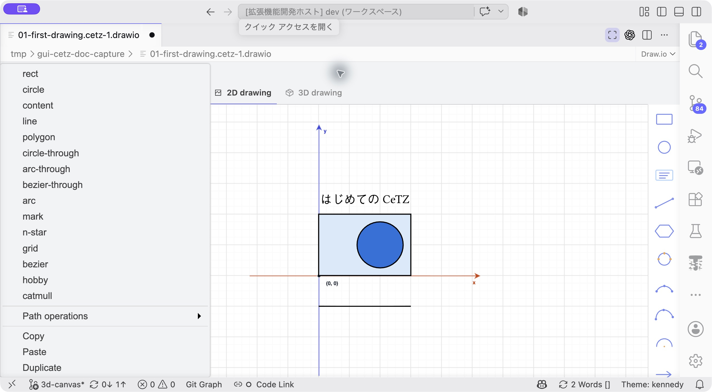

# コマンドとキー操作

[ドキュメント一覧](README.md)

## VS Codeのコマンドパレット

| コマンド名 | 用途・実行場所 |
| --- | --- |
| CeTZ: Open GUI Editor | `.typ`内のキャンバスを開く。CodeLensの▶ GUI CeTZと同じ入口 |
| CeTZ: Sync GUI From Typst | 開いているGUIを現在のTypstから再構築する |
| CeTZ: Select Shape in GUI | GUIで開いている図形の呼び出し内にカーソルを置いて実行し、GUI側を選ぶ |
| CeTZ: Insert Shape | キャンバス内にカーソルを置き、選んだテンプレートを挿入する。GUIタブからも利用可能 |
| CeTZ: Export PDF, SVG or PNG | アクティブな`.typ`文書全体を出力する |

`.typ`エディターの右クリックにも、GUIを開く・図形を挿入する・出力する項目があります。GUIタブから出力する場合はCeTZメニューを使います。

## GUIのキー操作

文字入力欄の中では、通常のテキスト編集を優先します。

| 操作 | macOS | Windows／Linux |
| --- | --- | --- |
| コピー | ⌘C | Ctrl+C |
| 貼り付け | ⌘V | Ctrl+V |
| 複製（2D） | ⌘D | Ctrl+D |
| グループ化（2D） | ⌘G | Ctrl+G |
| グループ解除（2D） | ⇧⌘G | Ctrl+Shift+G |
| 前へ／後ろへ（2D） | ⌘] / ⌘[ | Ctrl+] / Ctrl+[ |
| Undo | ⌘Z | Ctrl+Z |
| Redo | ⇧⌘Z | Ctrl+Shift+Z |
| 削除 | Delete／Backspace | Delete／Backspace |
| 図形を1グリッド移動（2D） | 矢印キー | 矢印キー |
| 図形を5グリッド移動（2D） | Shift＋矢印 | Shift＋矢印 |
| 作図・対応するドラッグを中止 | Esc | Esc |
| Hobby／Catmullの作図を終了 | Enterまたはダブルクリック | Enterまたはダブルクリック |
| XYZ入力を確定（3D） | Enter | Enter |
| XYZ入力を1段階戻す（3D） | BackspaceまたはBackボタン | BackspaceまたはBackボタン |
| 平面回転を15°刻みにする（3D） | ハンドル操作中にShift | ハンドル操作中にShift |

Outlineの高さ調整境界にフォーカスがある場合、矢印キーは境界のサイズ調整に使います。3Dの通常ドラッグはOrbit、2Dの通常ドラッグは図形の移動です。

**操作：** 左上のCeTZをクリックします。メニューは縦に長いため、下の項目はメニュー内をスクロールして探します。

## CeTZメニューで探せる操作

- 作図：15種類の2Dツール。3Dでは平面追加とXYZの線・文字。
- 選択物：Copy、Paste、Duplicate、Group selected、Ungroup selected、Delete selected。
- 配置：Bring forward、Send backward、6種類のAlign、2種類のDistribute。
- 接続：Connect selected、Reconnect、共有点の作成。
- パス：Path operationsの合成・切り抜き・囲み枠。
- 移動先：Go to Typst call。
- 表示・保存：Zoom in／out、Fit view、Export PDF, SVG or PNG。
- 履歴：Undo、Redo。

選択数や現在の2D／3Dモードによって利用可能な項目は変わります。個別の条件は各機能のガイドを参照してください。
