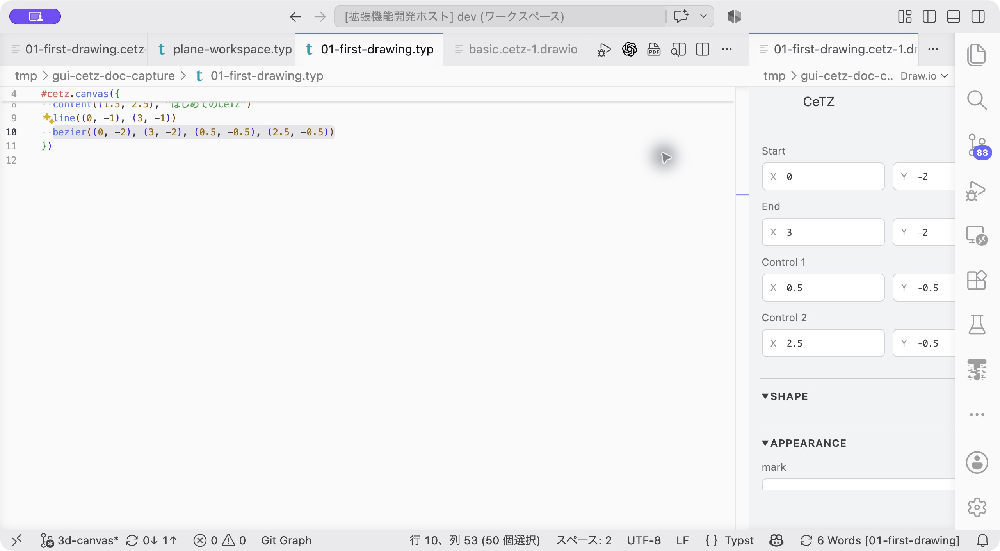

# エディターの使い方

[ドキュメント一覧](README.md) · [実際に試す](tutorials/01-first-drawing.md)

## キャンバスを開く

`.typ`ファイル内の`cetz.canvas`の上にある **▶ GUI CeTZ** をクリックします。右側にDraw.ioの編集タブが開きます。

コマンドパレットから **CeTZ: Open GUI Editor** を実行する場合は、カーソルのあるキャンバスを開きます。カーソルがキャンバスの外にある場合は最初のキャンバスを選びます。複数のキャンバスがあるときは、それぞれのCodeLensから開くと対象が明確です。

## 画面の見方

**画面の対応：** 左が図形一覧、上が2D／3D切り替え、中央が作図領域、右が追加ツールです。

| 場所 | 役割 |
| --- | --- |
| 上部の`2D drawing` / `3D drawing` | 通常の2D、または3D平面・投影の編集に切り替えます。 |
| 左のWorkspace | 座標系、グリッド、3Dのカメラ・平面を設定します。 |
| 左のOutline | ソース順の図形一覧。選択、グループの展開、並び替えに使います。 |
| 左のProperties | 選択した図形の座標・形・文字・色・線などを編集します。 |
| 中央 | Typstが描画した図と、編集用の選択枠・制御点・ガイドです。 |
| 右のパレット | 図形の追加ツールです。2Dと3Dで内容が変わります。 |
| CeTZメニュー | 描画、選択物の編集、整列、履歴、ズーム、出力をまとめています。 |

CeTZ文書ではDraw.ioの通常メニューや図形ライブラリの一部を隠し、対応する操作を表示します。通常のDraw.ioファイルは標準の画面を使います。

## 図形を選ぶ

キャンバス上の図形、またはOutlineの行をクリックします。2Dでは修飾キーを押しながらクリックして複数選択できます。制御点を選んだ場合も、その点を持つ図形がPropertiesとOutlineの対象になります。

GUIで図形を選ぶと、Typstエディターで対応する呼び出しが選択されます。複数選択では複数のソース範囲を選択し、操作のフォーカスはDraw.ioに残ります。コードへ移動して編集したいときは **Go to Typst call** を使います。

Outlineはグループを展開・折りたたみできます。行のホバーで図形を強調表示し、選択すると図形の位置へスクロールします。Outlineの下の境界をドラッグすると高さを変更できます。境界にフォーカスして矢印キーでも調整でき、ダブルクリックで自動の高さに戻ります。

**操作：** 円をクリックするかOutlineの`circle`を選びます。青いハンドルとPropertiesが出たら、編集対象を選べています。

## 図形を追加する

1. 右側の図形アイコン、またはCeTZメニューの図形名を選びます。
2. 画面の案内に従って点をクリックします。追加前の形が青いプレビューで表示されます。
3. 必要な点を指定するとCeTZのコードが追加され、Typstによる描画へ切り替わります。

**Esc**または右クリックで作図を中止できます。別のアイコンを選ぶとツールを切り替えます。`hobby`と`catmull`は2点以上を指定し、Enterまたはダブルクリックで終了します。各図形のクリック順は[図形リファレンス](shapes.md)を参照してください。

VS Codeの **CeTZ: Insert Shape** は、選んだ図形のテンプレートをソースへ挿入するコマンドです。キャンバス上のクリック作図とは異なります。`.typ`側から使う場合は、挿入先のキャンバス内にカーソルを置きます。

**操作：** 右の`line`アイコンを押し、始点、終点の順にキャンバスをクリックします。確定後の線は次のように表示されます。

## 移動・サイズ変更・回転

- **移動**：図形の選択枠をドラッグします。複数選択は同じ移動量で動きます。
- **細かな移動**：矢印キーで現在のグリッド1段階、Shift＋矢印で5段階動かします。
- **サイズ変更**：対応する図形の選択枠ハンドルをドラッグします。数値座標・半径などで表せる変更が対象です。
- **回転**：左側の回転コントロールで15°ずつ、または角度を入力して回転します。
- **一様拡大縮小**：対応するリテラル図形ではサイズスライダーを使えます。

回転は図形固有の`angle:`、または編集可能な`scope({ rotate(...) ... })`で表します。GUIが作った回転用ラッパーは0°へ戻すと外れます。文字の選択枠を伸ばして文字サイズを変える操作や、星を片方向だけ伸ばす操作などは対応していません。

## 制御点を動かす

直線・Bezier・Hobby・Catmullなどには点ハンドルがあります。Bezierの端点は青、制御点はオレンジで、制御線を破線で表示します。ハンドルはズームしても同じ画面サイズを保ちます。

円弧には始点、中心、終点のハンドルがあります。中心を動かすときは両端を維持するように位置を制限します。終点の操作では終了角と半径などを更新し、楕円弧の点は楕円上を動きます。

点のドラッグ中は他の図形の端や中心への整列ガイドを表示します。ガイドに合う軸は整列を優先し、残りの軸にはグリッドを使います。自分自身の別ハンドルや背景画像、軸ラベルは吸着先になりません。

## 座標とグリッド

2Dの座標はCeTZと同じく、Xが右、Yが上です。`2D workspace`の **Grid and snap** でグリッドと吸着を切り替えます。グリッドを無効にすると自由な移動ができます。

| ズーム | グリッド間隔（CeTZ座標） |
| --- | --- |
| 100% | 0.25 |
| 200% | 0.125 |
| 400% | 0.0625 |
| 800% | 0.03125 |
| 1600% | 0.015625 |

図形の追加、移動、制御点、サイズ変更は同じ精度を使います。ズームを戻しても既存の座標を粗く丸め直すことはありません。通常のドラッグは図形のCeTZ上の基準点をグリッドへ合わせます。必要に応じてソース座標は小数点以下8桁まで保持します。

グリッド、座標軸、ハンドルは編集用です。Typstからの出力には含まれません。

**確認：** GUIで選んだ曲線に対応する`bezier(...)`が、Typstエディター側でも選択されます。

## ソース変更とUndo／Redo

GUIの変更は元の`.typ`へ反映され、Typstで再描画されます。Propertiesの入力は自動反映されますが、未完成の入力は確定されません。詳細は[プロパティ](properties.md)を参照してください。

GUIにフォーカスがあるときはCeTZメニューの **Undo / Redo**、または対応するショートカットでGUIの変更を戻せます。`.typ`側の編集にはVS CodeのUndo／Redoを使います。ソースを直接編集するとGUI用の履歴はクリアされ、現在のソースから表示を作り直します。

手動で再同期したいときは **CeTZ: Sync GUI From Typst** を実行します。GUIでの変更はエディターの文書へ書き込まれるため、最後に`.typ`を保存してください。
