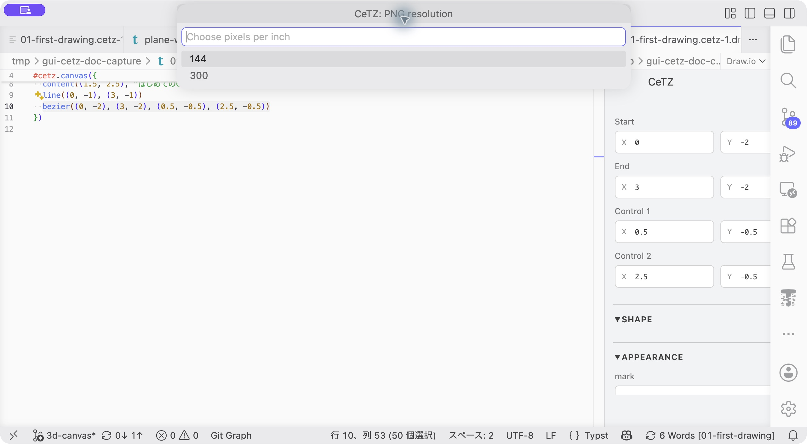

# 保存とPDF・SVG・PNG出力

[ドキュメント一覧](README.md)

## 保存するファイル

GUI操作は元の`.typ`文書へ書き戻します。保存するときはそのTypstファイルを保存してください。GUIの見た目だけを保存する別の正本は作りません。

編集用Draw.io文書は`gui-cetz:`の仮想ファイルシステム上にあります。`.typ`の隣にDraw.ioファイルは作成しません。VS CodeがGUIタブを復元する場合も、元のTypstから編集文書を作り直します。元の`.typ`は保存し、参照できる場所に置いてください。

古い版が作った`.cetz-N.drawio`は現在の保存先には使いません。必要な変更が`.typ`へ保存されていることを確認したうえで整理できます。

## GUIから出力する

1. CeTZメニューの **Export PDF, SVG or PNG** を選びます。`.typ`エディターからは **CeTZ: Export PDF, SVG or PNG** を実行します。
2. PDF、SVG、PNGのいずれかを選びます。
3. PNGでは解像度を144または300 ppiから選びます。
4. 保存先を選びます。

未保存の文書変更があれば保存してからTypst CLIでコンパイルします。保存できなかった場合は出力を中止します。

出力対象は**選択中の図形やキャンバスだけでなく、Typst文書全体**です。図だけが必要なら、独立した`.typ`へ置き、例えば次のページ設定を使います。

```typst
#set page(width: auto, height: auto, margin: 12pt)
```


**操作：** 出力コマンドを実行すると、この形式選択が開きます。出力したい形式を選んで確定します。

## ファイル名と複数ページ

`diagram.typ`の場合、保存ダイアログでは以下の名前を提案します。

| 形式 | 提案する名前 | 複数ページ |
| --- | --- | --- |
| PDF | `diagram.pdf` | 1つのPDFにまとめる |
| SVG | `diagram-{0p}.svg` | ページごとのファイル |
| PNG | `diagram-{0p}.png` | ページごとのファイル |

`{0p}`はTypstがページ番号へ置き換える部分です。複数ページのSVG／PNGを出す場合は、保存名にこの部分を残してください。



**操作：** PNGを選んだ場合だけ、次に解像度を選びます。その後に保存先を指定します。

## 含まれるもの・編集用の表示

図形、文字、カメラ角度、平面位置など、Typstソースに記録された内容が出力されます。編集用のグリッド、座標軸、選択枠、点ハンドル、平面背景は含まれません。図形として`grid(...)`で描いたグリッドはソースの一部なので出力されます。

3Dの回転中に表示する一時プレビューは出力に使いません。CeTZが計算した最終描画を使います。

## コマンドラインで出力する

```sh
typst compile diagram.typ diagram.pdf
typst compile diagram.typ 'diagram-{0p}.svg'
typst compile diagram.typ 'diagram-{0p}.png' --ppi 300
```

GUIの出力も同じTypst CLIを使います。失敗した場合は[トラブル対処](troubleshooting.md)でCLIと文書のコンパイルを確認してください。
