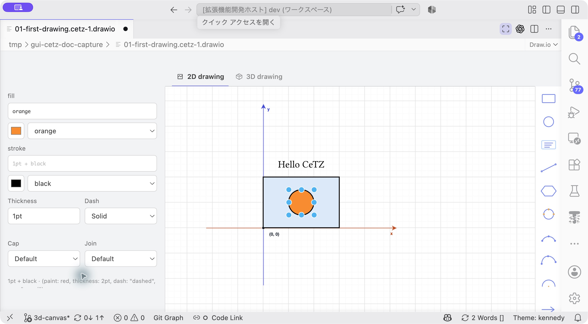

# プロパティの編集

[ドキュメント一覧](README.md) · [図形ごとの引数](shapes.md)

図形または制御点を1つ選択すると、左側のPropertiesに引数が表示されます。複数選択時は整列や接続など、選択物をまとめて扱うコントロールを使います。


**操作：** 左のPositionで位置を、radiusで半径を変えます。数値を入力する欄と、キャンバス上の選択図形を見比べてください。

## セクション

| セクション | 内容 |
| --- | --- |
| Geometry | 点の座標、文字やパスの内容など、位置引数 |
| Shape | 半径、角度、閉じるかどうかなど、図形固有の名前付き引数 |
| Appearance | 塗り、線、端点記号など |
| Advanced | 追加の名前付き引数、式の入力 |

表示される項目は選択図形によって変わります。投影や平面のPropertiesでは、投影角度などの引数を表示します。

## 座標と式

数値の点はX/Y、3Dの点はX/Y/Zに分かれて表示されます。小数を直接入力でき、**ƒx**へ切り替えると元のTypst式を編集できます。

| 指定したいもの | 入力例 |
| --- | --- |
| 2D座標 | `(1.25, 2)` |
| 3D座標 | `(1, 2, 3)` |
| 図形のアンカー | `"box.east"` |
| 相対座標 | `(rel: (1, 0))` |
| 半径 | `0.75`または`(1, 0.5)` |
| 角度 | `30deg` |
| 真偽値 | `true` / `false` |

式は対象のCeTZ引数として有効である必要があります。画面の見本値は未指定時の入力の目安です。空欄の値が常にソースへ書かれるわけではありません。


**操作例：** Xを`2`、radiusを`0.75`に変更した結果です。右の図が更新されたことも確認します。

## 塗りと線

塗り・線の色は、Typstの名前付き色パレットまたはRGBピッカーから選べます。式欄には`blue.lighten(80%)`、`rgb("#336699")`なども入力できます。変数から色を与える場合は、その変数の定義をソースで変更できます。


**操作：** Fillの色名メニューを開き、色を選びます。直接式を入力するときは、その上の式欄を使います。

線は単純な加算と辞書形式を扱います。

```typst
stroke: 1pt + black
stroke: black + 1pt
stroke: (paint: red, thickness: 2pt, dash: "dashed", cap: "round")
```

専用欄では以下を変更できます。

| 設定 | 意味・選択肢 |
| --- | --- |
| Thickness | `1pt`、`0.5pt`などの線幅 |
| Dash | Solid、Dashed、Dotted、Dash dot、Dense dash、Loose dash |
| Cap | Default、Butt、Round、Square |
| Join | Default、Miter、Round、Bevel |

辞書の一部を変更するときは他のフィールドを維持します。独自の式で構成された線は、式欄またはソースで調整してください。

省略して上位のスタイルを引き継ぐ場合は、任意項目の欄を空にします。明示的に描画を無効にする`fill: none`や`stroke: none`とは区別してください。



**操作：** 線幅はThickness、破線はDashで変更します。左パネルを下へスクロールすると、これらの欄が見つかります。

## 矢印・端点記号

線の始点・終点は個別に設定できます。片側を変更しても、反対側と既存の追加オプションは維持します。

選択肢はCeTZ 0.5.2の16種類です。

`triangle`、`stealth`、`curved-stealth`、`bar`、`ellipse`、`circle`、`bracket`、`diamond`、`rect`、`hook`、`straight`、`barbed`、`plus`、`x`、`star`、`parenthesis`。

例えば`mark: (start: "circle", end: ">")`は始点に円、終点に三角の矢印を付けます。独自のmark式を使っている場合は、元の式を編集します。

## 文字

`content`の **Text** 欄は、文字をそのまま入力できます。日本語、改行、句読点、空文字に対応しており、Typstの`[...]`を自分で付ける必要はありません。単純な文字列は図形ラベルからも変更できます。

数式や装飾付きの本文を使う場合は **ƒx** に切り替えます。例えば`[$x^2 + y^2$]`のようにTypstの内容式を入力します。複雑なマークアップを単純なText欄へ変換できない場合は、式のまま編集します。


**操作：** `content`を選び、Textへ文字をそのまま入力します。`ƒx`はTypst式へ切り替えるボタンです。

## 追加の引数

**Advanced → + Add property** で名前とTypstの値を指定すると、未表示の名前付き引数を追加できます。名前は英字で始め、英数字・`_`・`-`を使います。既存の項目と同じ名前は追加できません。

追加できるのは、使用中のCeTZバージョンと対象関数が受け付ける引数です。新しい項目を追加しても、その関数に存在しない引数を使えるようにはなりません。パス操作の引数やオペランド本文も、対応するPropertiesから編集できます。

## 自動反映と未完成入力

テキスト・数値の変更は、入力が約400ms止まったとき、または欄を確定したときに反映します。メニュー選択は即時反映します。日本語IMEの変換中は確定を待ちます。

反映前にTypstで描画を検証します。未完成の式や不正な値は欄に保持し、最後に有効だったソースと図を維持します。エラー表示がなくても、入力が適用されていない場合があります。値を完成させて、ソースとプレビューが更新されたことを確認してください。

描画処理中の追加入力や別図形の選択でも入力を維持し、自動更新ごとにUndoの単位を作ります。未完成の入力がある場合は、2D／3Dタブを切り替える前に修正・完了する必要があります。
