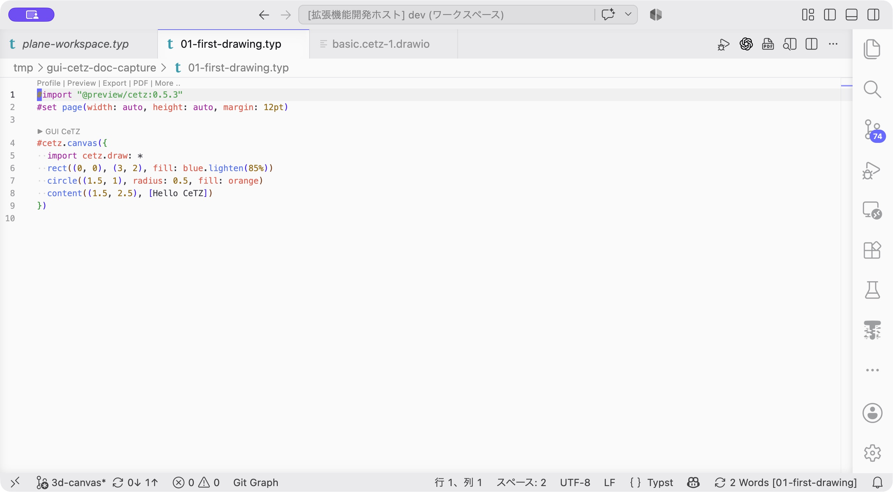
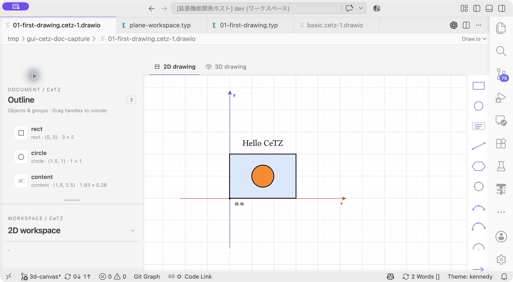
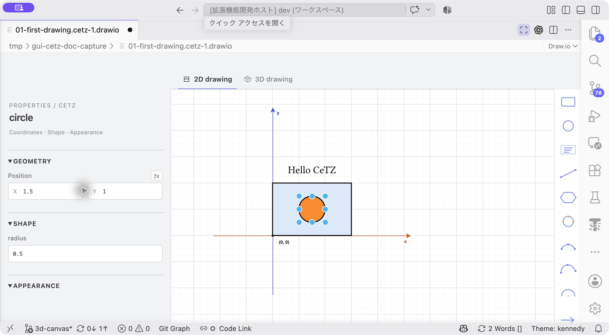
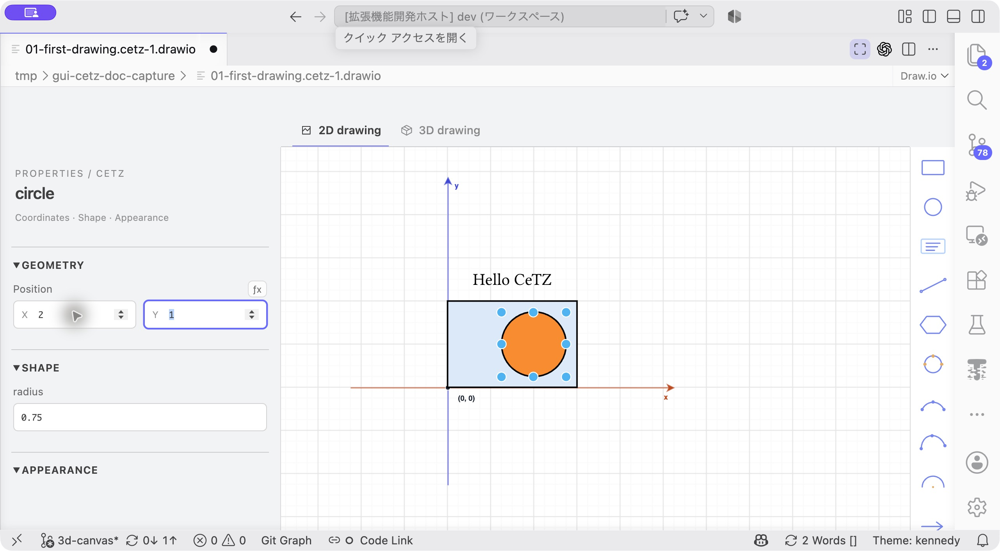
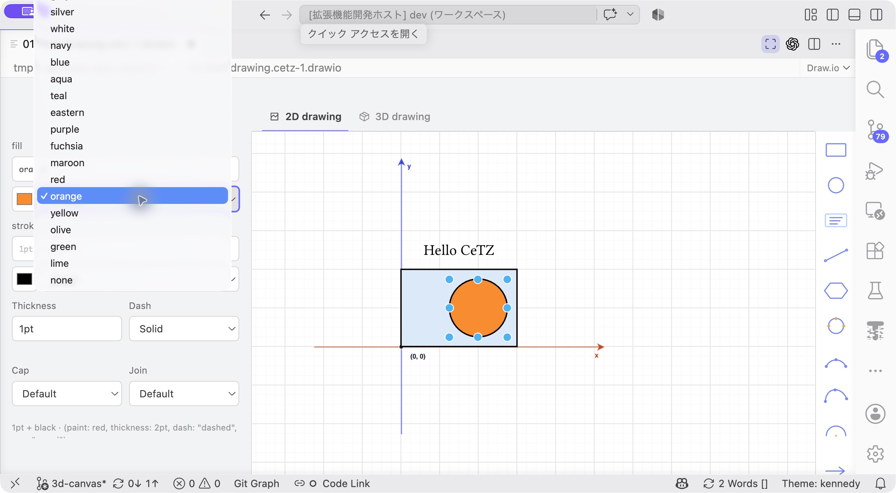
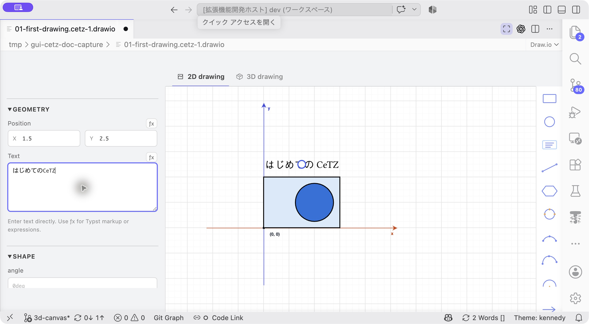
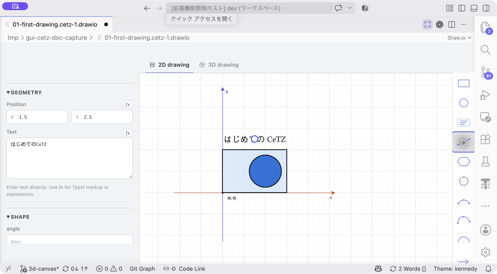
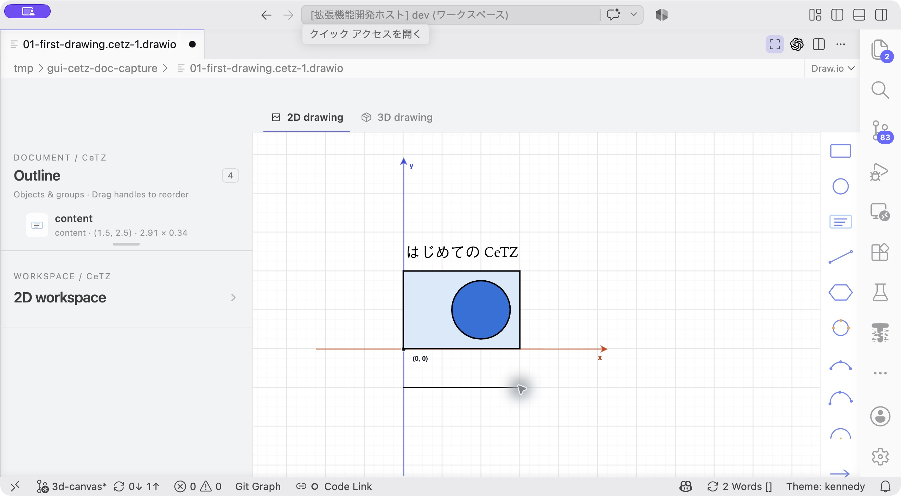
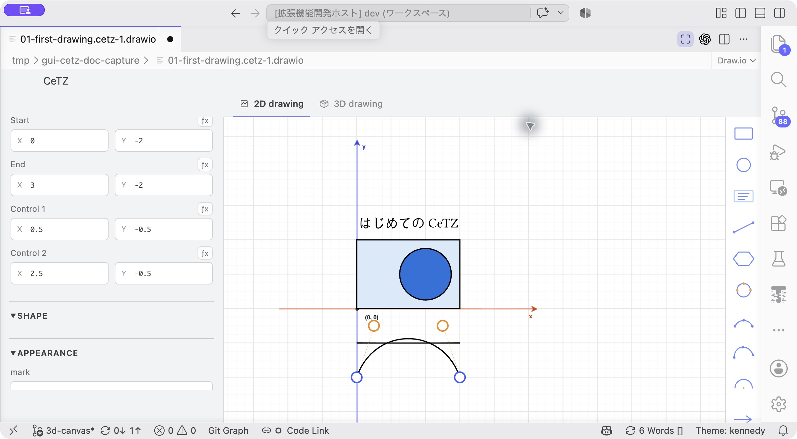
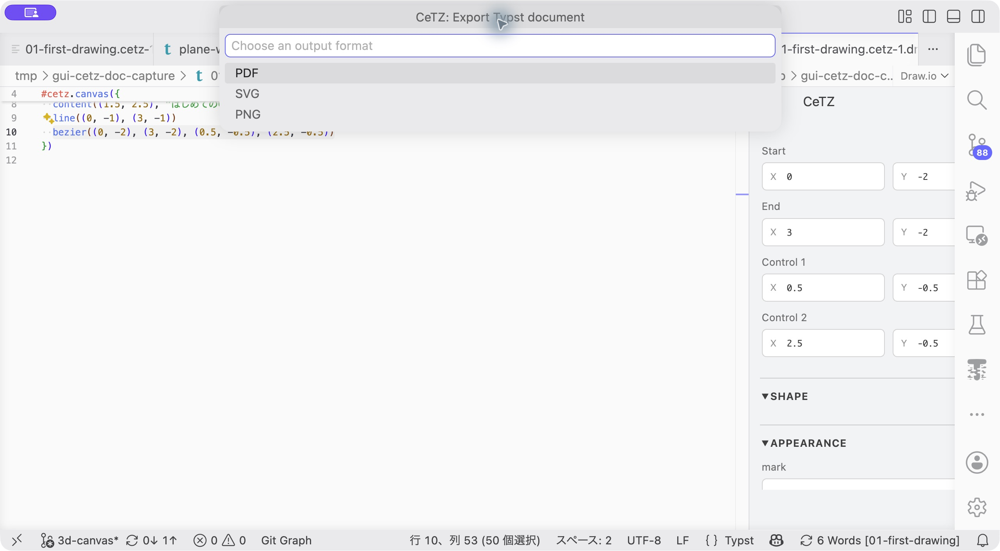

# チュートリアル1：はじめての作図

[ドキュメント一覧](../README.md) · 次：[接続線のある図](02-connected-diagram.md)

**目標：** 図を開き、図形の追加・位置調整・色・文字・曲線を編集して保存します。[インストール](../installation.md)が済んでいることを前提にします。

## 1. 開始ファイルを用意する

[01-first-drawing.typ](code/01-first-drawing.typ)を自分の作業場所へコピーし、VS Codeで開きます。内容は次のとおりです。

```typst
#import "@preview/cetz:0.5.3"
#set page(width: auto, height: auto, margin: 12pt)

#cetz.canvas({
  import cetz.draw: *
  rect((0, 0), (3, 2), fill: blue.lighten(85%))
  circle((1.5, 1), radius: 0.5, fill: orange)
  content((1.5, 2.5), [Hello CeTZ])
})
```

`cetz.canvas`上の **▶ GUI CeTZ** を押します。初回はDraw.ioのCeTZプラグインを許可します。長方形、円、文字が表示されれば準備完了です。



**ここをクリック：** `cetz.canvas`の直前の **▶ GUI CeTZ** を押すと、次の編集画面が開きます。

## 2. 円を動かして、コードを見る



**画面を確認：** 中央に長方形・円・文字、左にOutline、右に追加ツールがあります。

Outlineで`circle`を選び、キャンバス上で右へドラッグします。`.typ`側の`circle`の中心座標が変わることを確認します。グリッドの正確な位置に合わせるには、PropertiesのPositionのXを`2`、Yを`1`にします。



**この欄を編集：** 左のPosition X/Yと、その下のradiusを使います。

円の`radius`を`0.75`に変更します。入力後に少し待ち、円とソースが更新されることを確かめます。Geometryの座標は数値、radiusは半径です。

**確認：** 長方形のコードと文字のコードはそのままで、円の位置と半径だけが変わります。



**ここまでの結果：** 円が右へ移動し、大きくなっています。入力欄と図の両方で確かめます。

## 3. 色・線・文字を変える

円を選んだまま、AppearanceのFillで好きな色を選びます。Strokeの色を`navy`、Thicknessを`2pt`にします。Typstの式で色を指定したい場合は、Fillの式欄へ`orange.lighten(30%)`などを入力します。



**ここを選択：** Fillの色名メニューから色を選びます。撮影例ではこのあとblueを選んでいます。

次にOutlineの`content`を選び、Text欄へ`はじめてのCeTZ`と入力します。日本語の変換を確定し、図へ反映されるのを待ちます。Text欄では`[...]`で囲む必要はありません。

**確認：** 色・線幅・文字が変わり、入力した内容がTypstの引数へ反映されます。



**ここまでの結果：** Textに入力した「はじめてのCeTZ」がキャンバスへ反映されています。

## 4. 線を追加する

1. 右側の`line`アイコンを選びます。
2. 長方形の下など、重ならない位置を始点としてクリックします。
3. 右へ少し離れた位置を終点としてクリックします。
4. 線を選んで、終点の記号を`triangle`にします。



**ここをクリック：** 右の斜めの線のアイコンがlineです。次にキャンバス上で始点と終点をクリックします。

点を正確に指定したい場合は、追加後にPropertiesのStartを`(0, -1)`、Endを`(3, -1)`へ調整します。X/Yの欄にはそれぞれの数値を入力します。

作図を間違えたら、確定前はEsc、確定後はCeTZメニューのUndoで戻せます。



**ここまでの結果：** 長方形の下に線が追加されます。矢印の設定は、この線を選んでから行います。

## 5. 曲線の制御点を触る

右側の`bezier`を選び、始点 → 終点 → 制御点1 → 制御点2の順に4点をクリックします。例えば、追加後のPropertiesで次の値に揃えると山形の曲線になります。

| 点 | X | Y |
| --- | --- | --- |
| Start | 0 | -2 |
| End | 3 | -2 |
| Control 1 | 0.5 | -0.5 |
| Control 2 | 2.5 | -0.5 |

オレンジの制御点をドラッグし、曲がり方が変わる様子を見ます。青い端点は曲線の両端を動かします。



**ここをドラッグ：** オレンジの点がControl 1／2、青い点がStart／Endです。左の数値欄でも同じ点を調整できます。

## 6. 精度と履歴を試す

CeTZメニューのZoom inで拡大し、グリッドの刻みが細かくなることを確認します。図形を選び、矢印キーとShift＋矢印キーで位置を調整します。

GUIにフォーカスした状態でUndo／Redoを試します。ソースを直接編集するとGUI用の履歴がクリアされるため、この練習ではGUI操作を続けてから戻してください。

## 7. 保存して出力する

`.typ`を保存します。CeTZメニューの **Export PDF, SVG or PNG** からPDFを選んで出力します。教材はページサイズが自動なので、図の周りに余白を付けたPDFになります。選択枠や編集用グリッドは出力されません。



**ここを選択：** PDFを選び、次の保存先指定へ進みます。

完成時には、移動した円、新しい文字、矢印、Bezier曲線がソースに残ります。各ツールのクリック順は[図形リファレンス](../shapes.md)、入力の詳細は[プロパティ](../properties.md)で確認できます。
