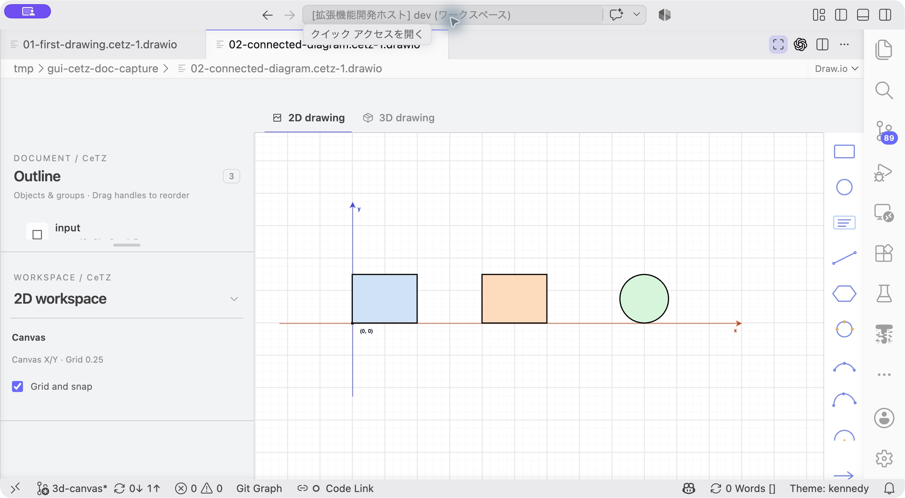
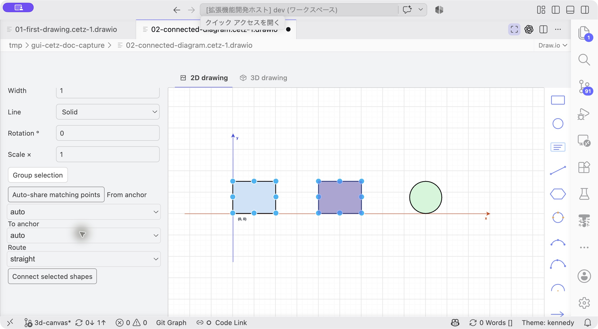
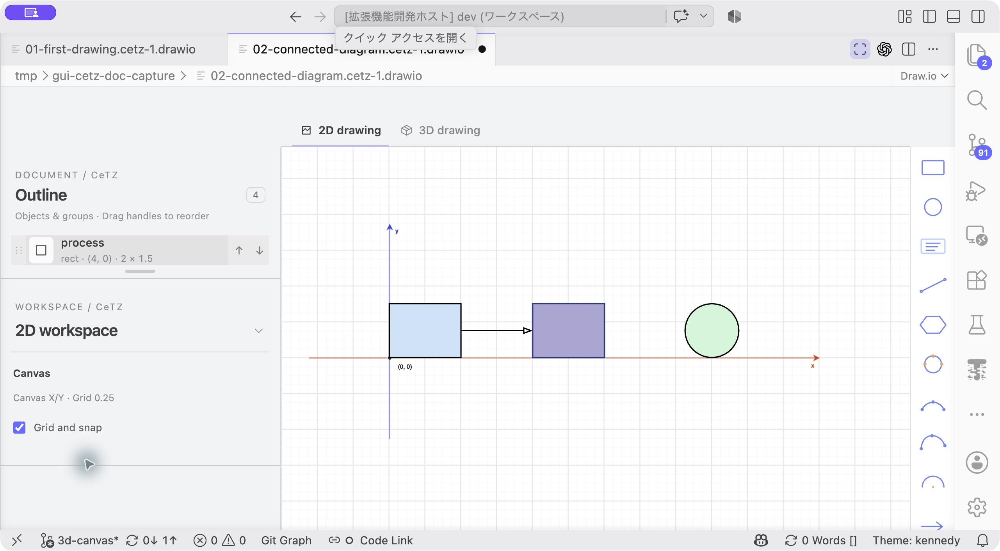
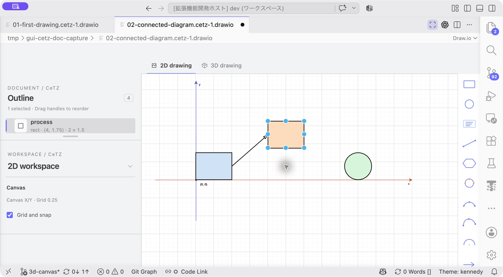

# チュートリアル2：移動に追従する接続線

[ドキュメント一覧](../README.md) · 前：[基本作図](01-first-drawing.md) · 次：[切り抜きと囲み枠](03-path-design.md)

**目標：** 3つのノードを接続し、ノードを動かしても線が追従する図を作ります。基本的な選択とPropertiesの操作は[チュートリアル1](01-first-drawing.md)を参照してください。

## 1. 3つの図形を開く

[02-connected-diagram.typ](code/02-connected-diagram.typ)をコピーして開き、**▶ GUI CeTZ** を押します。左の長方形`input`、中央の長方形`process`、右の円`output`が表示されます。

```typst
#import "@preview/cetz:0.5.3"
#set page(width: auto, height: auto, margin: 12pt)

#cetz.canvas({
  import cetz.draw: *
  rect((0, 0), (2, 1.5), name: "input", fill: blue.lighten(80%))
  rect((4, 0), (6, 1.5), name: "process", fill: orange.lighten(70%))
  circle((9, 0.75), radius: 0.75, name: "output", fill: green.lighten(80%))
})
```

名前は、接続線が図形上の点を参照するために使います。画面へ文字として表示するラベルとは別です。



**開始状態：** この時点では線がありません。左と中央の長方形から接続を作ります。

## 2. 長方形同士を接続する

1. Outlineで`input`と`process`を修飾キー付きクリックで複数選択します。
2. 接続コントロールのFrom anchorを`east`、To anchorを`west`にします。
3. Routeを`straight`にし、**Connect selected shapes** を押します。
4. 追加された`line`の始点と終点をソースで確認します。



**このボタンを押す：** 左パネルを下へスクロールして接続欄を出します。画像の`auto`でも、この配置ならeast→westを自動で選びます。手順のように辺を明示しても構いません。

この教材の順序では、意図する接続は`"input.east"`から`"process.west"`です。逆向きになった場合は、線のPropertiesの式欄で始点・終点をこの参照へ合わせます。終点の記号に`triangle`を選ぶと矢印になります。



**作成結果：** InputとProcessの間に矢印が追加されます。

`input`をドラッグして動かします。線の始点が長方形に追従することを確かめます。Undoで元へ戻して次に進みます。



**追従を確認：** 撮影例ではProcessを上へ動かしています。接続元・先のどちらを動かしても、線は参照先に追従します。

## 3. 直角に曲がる接続を作る

`process`と`output`を選び、Routeを`elbow`、接続辺を`east`と`west`にして接続します。線を選び、終点に矢印を付けます。

`output`を少し上へ動かします。終点だけでなく、曲がる経路が追従する様子を確認します。これは独立した数値線分ではなく、名前付きアンカーに基づく接続です。

## 4. 接続先を変える

最初に作った直線と`output`を選びます。Reconnect endを`end`、Target anchorを`west`にし、**Reconnect to selected shape** を押します。

線が`input`から`output`へつながることを確認します。この操作をUndoで戻せば、元の`input`→`process`→`output`の図になります。

## 5. ラベルをコードで加える

`.typ`のキャンバス末尾へ次を追加します。

```typst
content("input.center", [Input])
content("process.center", [Process])
content("output.center", [Output])
```

GUIの更新を待ちます。各図形を動かすと文字も中心へ追従します。これは名前付きアンカーを使う別の例です。ソースを直接編集したため、ここからのGUI履歴は新しく始まります。

## 6. 配置を仕上げる

必要なら3つのノードを選び、**Align middles** などで揃えます。配置操作は対応する数値図形を対象にしてください。アンカー式で位置を決めたラベルや接続線を、同時に整列し直す必要はありません。

保存して、ノードの座標と、ノード名を参照する線・ラベルが残ることを確認します。複製・グループ化・共有点も使いたい場合は[配置と接続](../arrangement-and-connections.md)へ進んでください。
