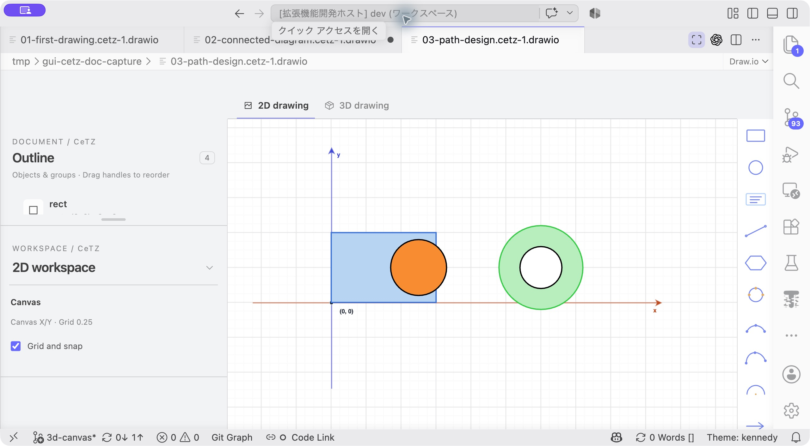
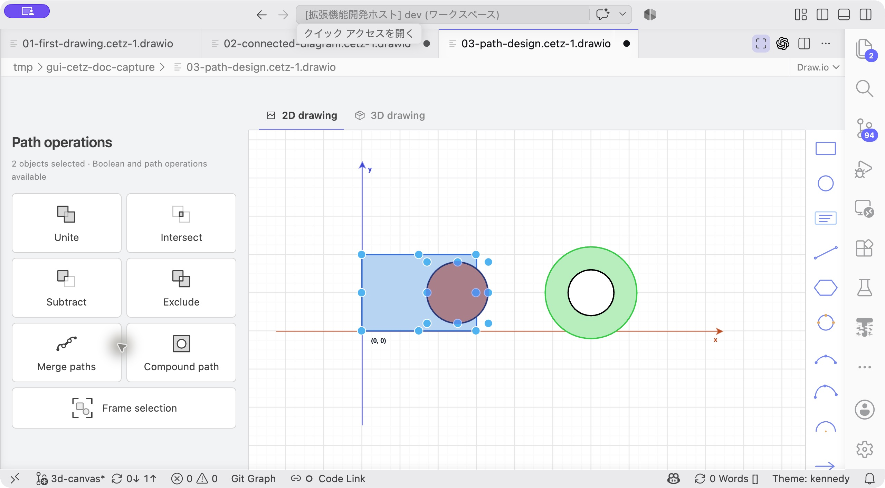
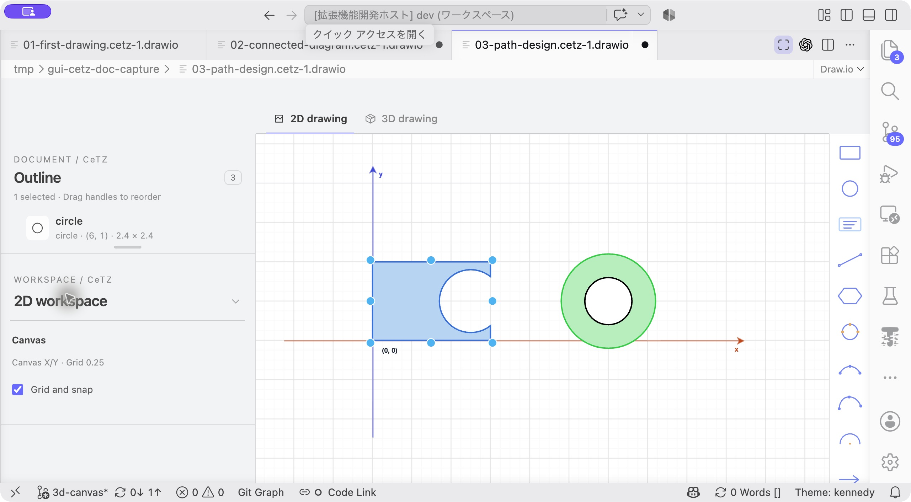
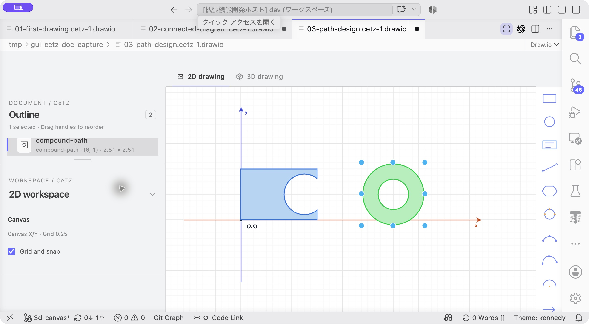
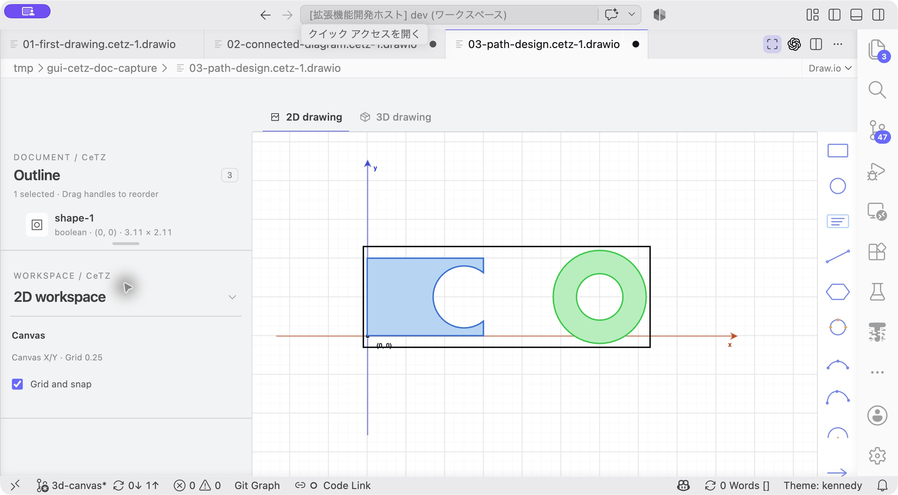

# チュートリアル3：切り抜き・穴・囲み枠

[ドキュメント一覧](../README.md) · 前：[接続線](02-connected-diagram.md) · 次：[3D平面](04-3d-workspace.md)

**目標：** 長方形を円で切り抜き、穴のあるパスと、内容に追従する枠を作ります。教材はBooleanが使えるCeTZ 0.5.3を指定しています。

## 1. 開始ファイルを開く

[03-path-design.typ](code/03-path-design.typ)をコピーして開き、**▶ GUI CeTZ** を押します。左側は長方形と重なる円、右側は大きな円の内側に小さな円がある図です。

```typst
#import "@preview/cetz:0.5.3"
#set page(width: auto, height: auto, margin: 12pt)

#cetz.canvas({
  import cetz.draw: *
  rect((0, 0), (3, 2), fill: blue.lighten(70%), stroke: blue)
  circle((2.5, 1), radius: 0.8, fill: orange)
  circle((6, 1), radius: 1.2, fill: green.lighten(65%), stroke: green)
  circle((6, 1), radius: 0.6, fill: white)
})
```



**開始状態：** 左の長方形と円を選んで切り抜き、右の2つの円を使って穴を作ります。

## 2. 長方形を円で切り抜く

Outlineで最初の`rect`と、その次の`circle`を選びます。**Path operations → Subtract** を押します。



**このボタンを押す：** 左のPath operationsで **Subtract** をクリックします。選択はソース順に解釈されます。

長方形の右側に円形の切り欠きができます。ソースでは元の2つの呼び出しを内包する`boolean(..., op: "difference")`になります。結果の塗りと線は先頭の長方形の明示指定を引き継ぎます。

**確認：** 基準はクリック順ではなくソース順です。長方形が先なので、長方形から円を引きます。



**ここまでの結果：** 長方形の右側が欠け、円が独立した図形としては残らなくなります。

## 3. 他の演算と比べる

Undoで元の2図形へ戻し、同じ図形を選んで **Unite** を試します。次はUndoして **Intersect**、さらにUndoして **Exclude** を試します。

それぞれの結果を見比べたら、Undoしてもう一度Subtractを適用します。演算結果が見えない場合でも、Outlineから選択できます。特に重なりがない図形のIntersectは空になります。

## 4. 円の内側を穴にする

右側の大きい円と小さい円だけを選び、**Compound path** を押します。

`compound-path`に`fill-rule: "even-odd"`が追加され、内側が穴になります。元の白い円を前に重ねた状態とは違い、穴は背景が透ける領域です。PDFやSVGに出力してもその形を維持します。

結果のPropertiesでFillを変更し、穴が埋まらないことを確かめます。



**ここまでの結果：** 右の2つの円が1つの複合パスになります。

## 5. 内容に追従する枠を作る

左側のBoolean結果と右側のCompound path結果を選び、**Frame selection** を押します。元の図形は残り、全体を囲む`rect-around`が追加されます。

枠を選び、Propertiesで`padding`を`0.2`にします。Fillは`none`にして、線の色・太さを調整します。次に元の図形の1つを動かし、枠の大きさが追従することを確認します。



**ここまでの結果：** 元の図形を残したまま、全体を囲む枠が追加されます。

## 6. 保存して構造を確認する

`.typ`を保存し、以下を確かめます。

- 切り抜きは元の呼び出しを内包する`boolean`である。
- 穴は`compound-path`の塗り規則で表されている。
- 囲み枠は図形名を参照し、固定座標の長方形にはなっていない。

ここでは閉じた図形を扱いました。開いた曲線同士の接続には **Merge paths** を使います。選択条件や、参照がある場合の制約は[パス操作](../path-operations.md)を参照してください。
