# チュートリアル4：2Dの図を3Dへ配置する

[ドキュメント一覧](../README.md) · 前：[切り抜きと囲み枠](03-path-design.md)

**目標：** 2Dの図を3D化し、2枚目の平面とXYZの線を追加して、平面内の作図と空間配置を使い分けます。

## 1. 2Dの図を開く

[04-3d-workspace.typ](code/04-3d-workspace.typ)をコピーし、**▶ GUI CeTZ** から開きます。教材は長方形と円、文字だけの2D図です。

```typst
#import "@preview/cetz:0.5.3"
#set page(width: auto, height: auto, margin: 12pt)

#cetz.canvas({
  import cetz.draw: *
  rect((0, 0), (3, 2), fill: blue.lighten(85%), stroke: blue)
  circle((1, 1), radius: 0.4, fill: orange)
  content((2, 1), [Plane A])
})
```

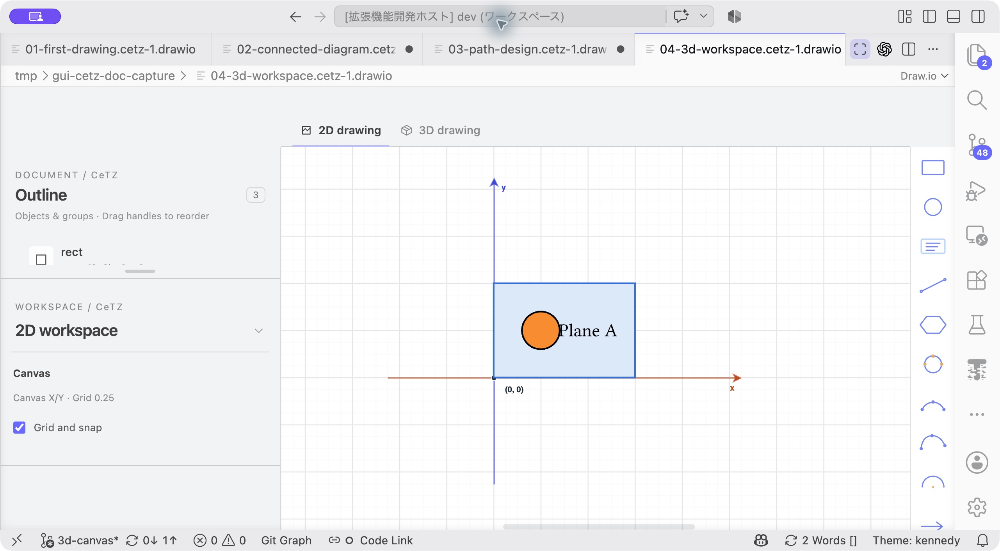

**開始状態：** 上はまだ **2D drawing** です。次に隣の **3D drawing** を押します。

## 2. 3Dへ切り替える

**3D drawing** タブを押します。元の図がXY平面に置かれ、投影付きの図になります。ソースに`ortho`と平面のコードが加わることを確認します。

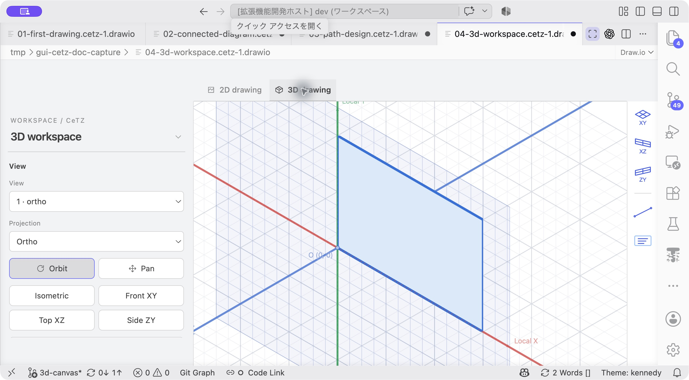

**ここまでの結果：** 図がXY平面に置かれ、左が3D workspaceへ切り替わります。右側のツールも平面追加とXYZの線・文字に変わります。

キャンバス上を左ドラッグして視点を回転します。下へドラッグするとX角、右へドラッグするとY角が変わります。左側のCameraにも数値が反映されます。**Isometric** を押して見やすい角度へ戻します。

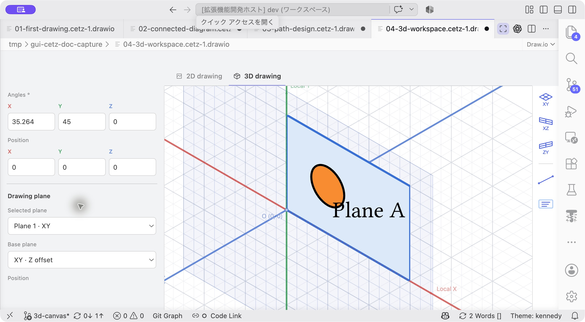

**この欄で確認：** AnglesのXYZが視角、PositionのXYZがカメラ位置です。Drawing plane以下の設定と混同しないようにします。

この角度はソースへ保存されます。作業画面の場所だけを動かしたいときは **Pan** を使い、回転へ戻るときは **Orbit** を押してください。

## 3. 平面内を2Dで編集する

1. 元のXY平面をクリックして選択します。
2. **Edit in 2D** を押します。
3. 円の位置をドラッグで変え、右の`line`ツールで線を追加します。
4. **3D drawing** へ戻ります。

編集した円と線が、同じXY平面の中に表示されます。2Dで使った座標は面内のX/Yであり、カメラ角度を変えても座標を書き直す必要はありません。

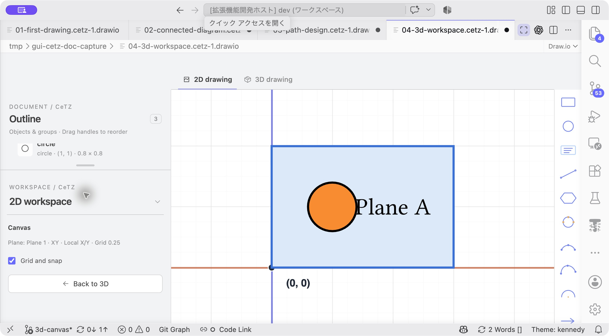

**この画面で作図：** 平面内の座標で編集します。左の`Plane: Plane 1 · XY · Local X/Y`で対象を確認し、**Back to 3D** または上のタブで戻ります。

## 4. XZ平面を追加する

右側の **XZ** 平面アイコンを押します。新しい平面が選ばれたことをDrawing planeで確認します。

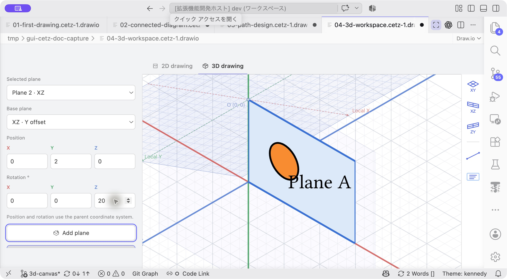

**この欄に入力：** Selected planeが **Plane 2 · XZ** であることを確認し、PositionとRotationへ指定値を入れます。画像は面内に図形を描く前の空の平面です。

Plane positionをX=`0`、Y=`2`、Z=`0`、Plane rotationをX=`0`、Y=`0`、Z=`20`にします。**Edit in 2D** を押し、`rect`で長方形を追加します。必要なら角の座標を`(0, 0)`と`(3, 2)`へ合わせ、Fillを薄いオレンジにします。

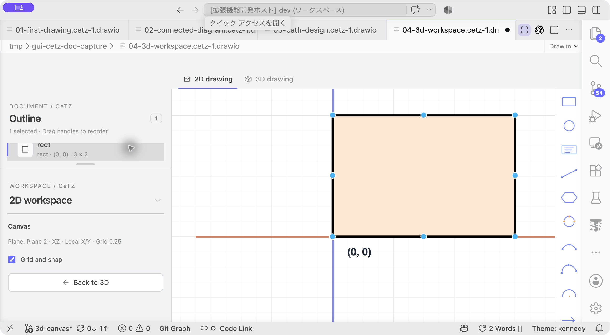

**ここまでの結果：** 左のOutlineで`3 × 2`、Canvasで`Plane 2 · XZ · Local X/Y`を確認します。Fillには`orange.lighten(80%)`を使っています。

`content`を追加してTextを`Plane B`にし、3Dへ戻ります。位置と角度の異なる2枚の平面が見えます。

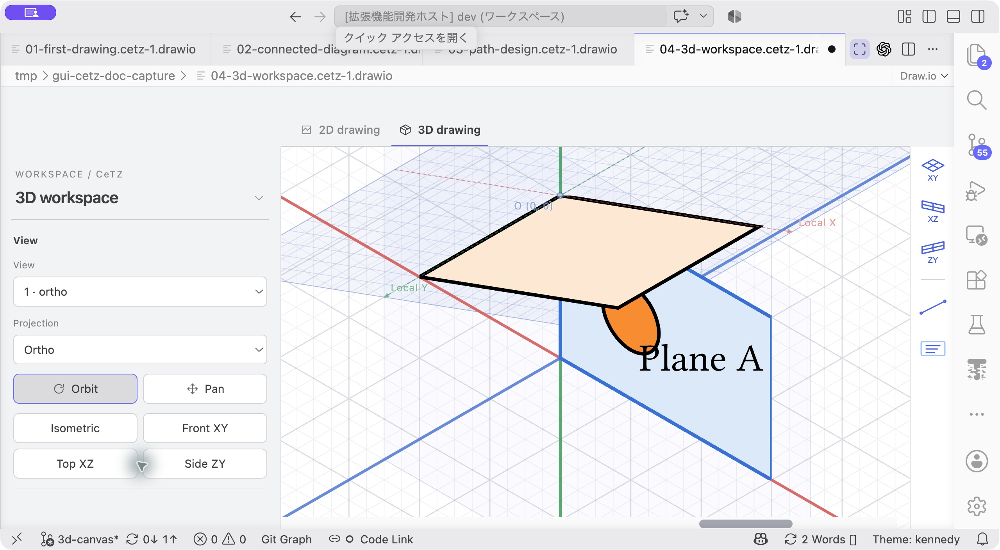

**戻った結果：** オレンジが追加したXZ平面、青が元のXY平面です。上の画像は、Plane Bの文字を追加する前の状態です。

**確認：** XZ平面の2D編集でも、画面上の座標欄はローカルX/Yです。回転前のローカルYは空間のZ方向に対応します。

## 5. ハンドルで平面を配置する

Plane Bを選び、青いZ矢印を少しドラッグします。平面全体が移動し、Plane positionのZが変わります。

RX／RY／RZのどれかをドラッグして回転し、Shiftを押すと15°刻みになることを試します。中止はEscです。確定した操作はUndoでまとめて戻せます。

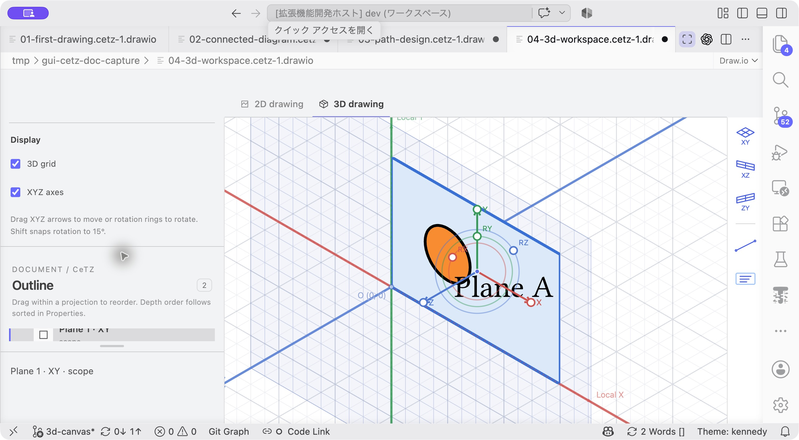

**ここをドラッグ：** 色付きの矢印は移動、RX／RY／RZは回転です。画像はPlane Aですが、追加したPlane Bも同じハンドルで配置します。

## 6. XYZ座標の線を追加する

3Dの`line`ツールを選び、各段階の数値入力で次を指定して、その都度Enterを押します。

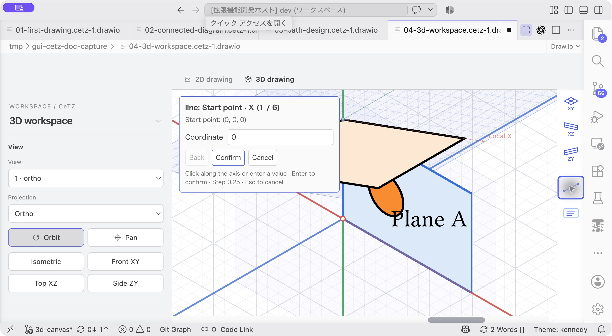

**ここに入力：** ダイアログの **Coordinate** 欄に数値を入れ、Enterまたは **Confirm** で進みます。見出しの`Start point · X (1 / 6)`で、今どの座標を入力しているか確認できます。

| 点 | X | Y | Z |
| --- | --- | --- | --- |
| Start | 0 | 0 | 0 |
| End | 3 | 2 | 2 |

始点X→Y→Z、終点X→Y→Zの6段階です。間違えた場合はBackで戻れます。この線は平面内ではなく、投影直下のXYZ線として追加されます。

線を選び、Propertiesで線の色を赤、太さを`1.5pt`にします。端点のハンドルをクリックすれば、その端点だけをXYZで指定し直せます。

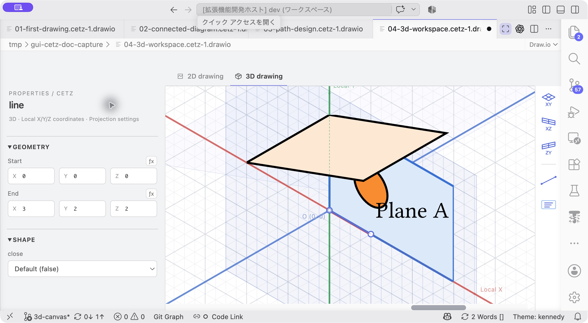

**入力結果を確認：** 左の **Geometry** にStartとEndのXYZが表示されます。線の設定欄が下に隠れている場合は、3D workspaceを折りたたみ、左パネルをスクロールします。

## 7. ガイドと投影を確かめる

Displayの **3D grid** と **XYZ axes** をそれぞれ切り替えます。選択面のローカル原点・軸はXYZ axesと連動します。これらは出力されない編集用ガイドです。

**Projection properties** を押し、`sorted`などの投影引数を確認します。ViewのProjectionからPerspectiveへ変更して見え方を試し、必要に応じてOrthoへ戻します。同じ面の塗りが円や文字を隠してしまう場合は、`sorted: false`にしてソース順の描画も試してください。円と文字が見えるスクリーンショットでは、この設定を使っています。

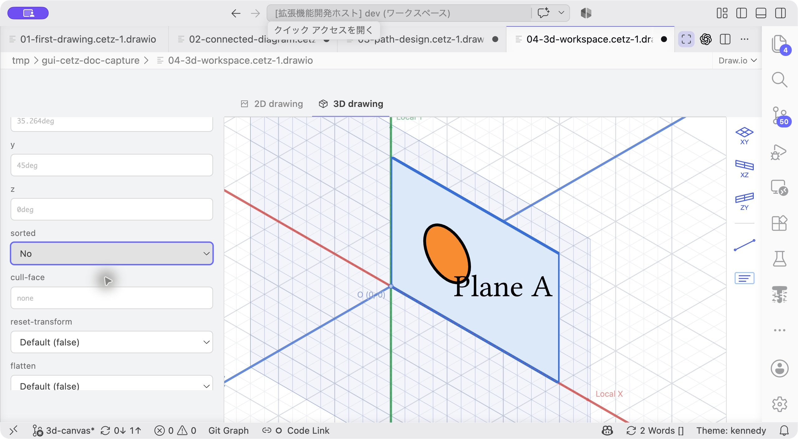

**この欄を確認：** 円や文字が塗りに隠れる場合、Projection propertiesのsortedを **No** にしてソース順で描画します。

## 8. 保存して出力する

`.typ`を保存し、PDFまたはSVGへ出力します。最後のカメラ角度、平面位置・回転、図形が出力に反映され、ガイドが含まれないことを確認します。

この操作に慣れたら、[複数平面を記述した例](../../examples/plane-workspace.typ)も開いてみてください。投影・平面・描画順と制約は[3D編集ガイド](../3d-guide.md)にまとめています。
